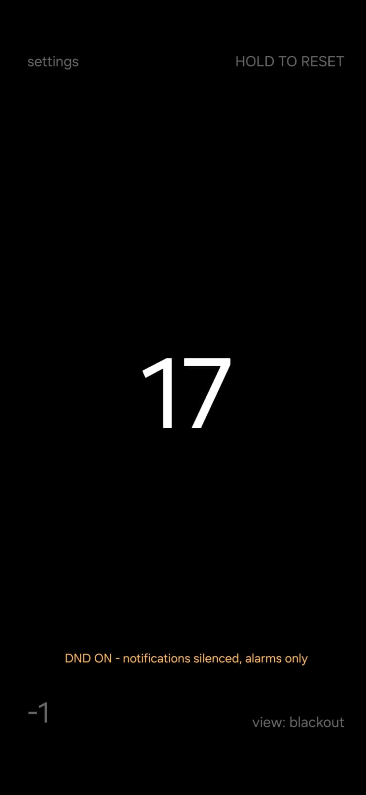
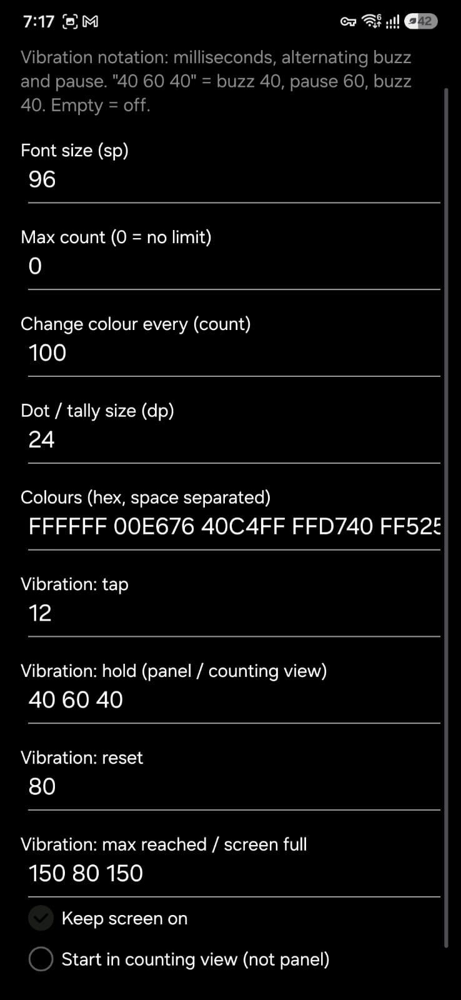
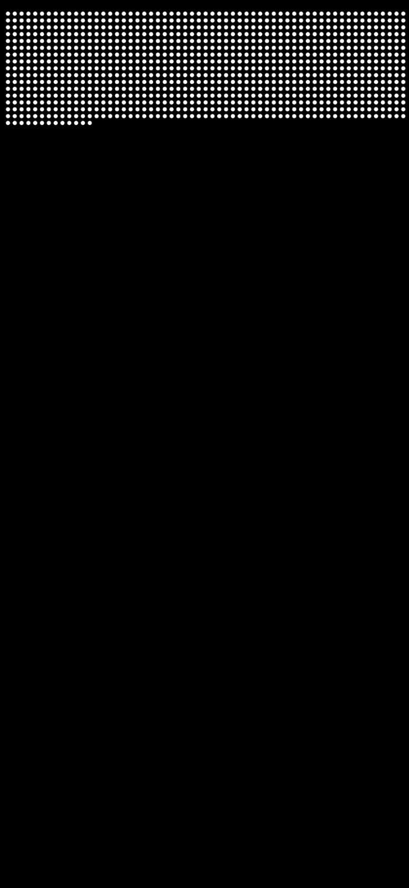
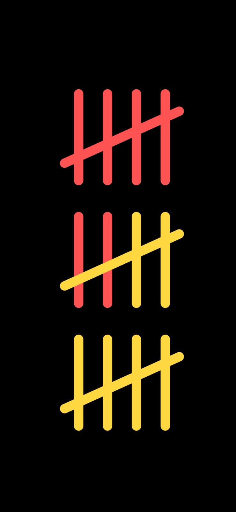
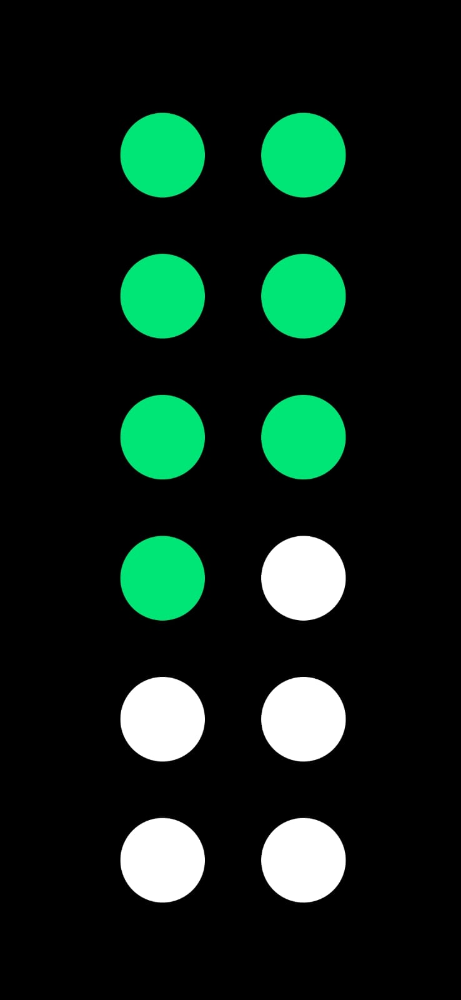
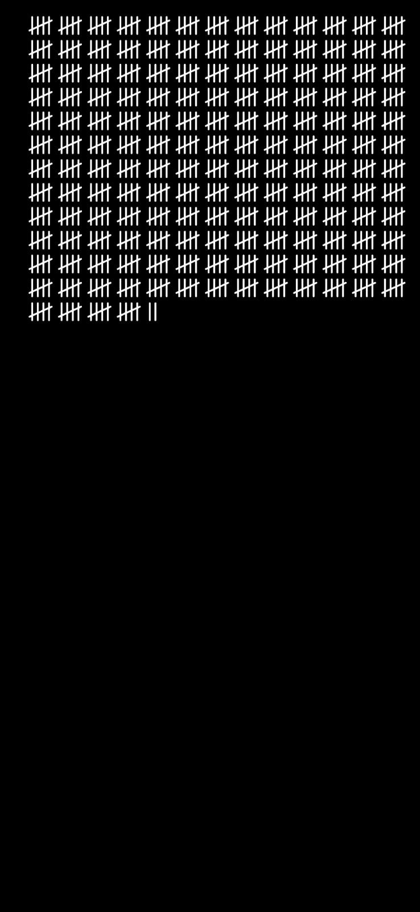
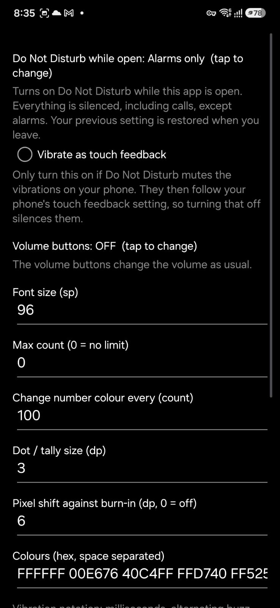

# weecounter

> **AI disclosure:** this app was written with AI-assisted coding (Claude by Anthropic). I direct the design, review the code and test it on my own device.

A tiny tap counter for AMOLED screens. Pure Java, no libraries, tiny APK. The only network use is the update check you start yourself in the settings.

<p>
  
  
  
  
  
  
  
  
</p>

(yes the third screenshot is a feature, you can count with ur screen off ish on amoled displays)

## Use

- **Tap** anywhere: count up, short vibration.
- **Hold** anywhere: switch between the panel (number and buttons) and the counting view.
- **Panel:** `-1` bottom left, `reset` top right (a tap explains, hold resets), `menu` top left (settings, profiles, edit layout, reset layout), `view` bottom right cycles the counting view. The `-1` and `view` buttons reach down to the screen edge.
- **Counting views:** blackout (pure black), dots, tally. Dots and tally take the number's colour: they fill one mark per tap, then drain one mark per tap (earliest first) until the next lap (every 100 by default), which changes the colour, buzzes and starts over. Counting never stops; an optional "count reached" target buzzes once when you hit it.
- **Volume buttons** (optional, off by default): count with the volume keys, e.g. both add one, or up adds and down subtracts. Set in settings.
- **Vibration patterns** are plain milliseconds, alternating buzz and pause: `40 60 40` = buzz 40, pause 60, buzz 40. Empty = off.

The display drifts a few pixels every 15 seconds to protect AMOLED screens from burn-in (configurable, can be turned off).

Optional (off by default): turn on Do Not Disturb while the app is open, either "priority only" or "alarms only". The previous setting is restored when you leave. Needs Do Not Disturb access, which you grant in Android's settings.

## Install and updates

Get the APK from the [latest release](https://github.com/santarl/weecounter/releases/latest), or let [Obtainium](https://obtainium.imranr.dev) keep it updated: [add weecounter to Obtainium](https://apps.obtainium.imranr.dev/redirect.html?r=obtainium://add/https://github.com/santarl/weecounter) (or paste `obtainium://add/https://github.com/santarl/weecounter` into the browser of that phone). Settings has an About section with the version, this project's link and a manual "check for update" that opens the APK download of a newer release in the browser. Test builds compare the latest commit on `main` with the one they were built from.

## Layout editor

Menu, then **Edit layout**: tap an element (menu, reset, -1, view, dhikr text, slide title, counter, footer, Do Not Disturb warning) to select it and show its bounding box. Drag inside to move it, drag an edge or a corner to resize it, or pinch to scale it. Text follows the height of its box. The layout is saved as you go. The check button (or back) leaves the editor; hold the undo button to reset the layout. **Reset layout** in the settings does the same.

## Dhikr profiles

Optional (settings, "Dhikr profile"). A profile is a UTF-8 text file, one file per profile, any language. A line like `---33` starts a slide that is counted 33 times (`0` skips it, `1` shows it once). The lines below it, up to the next `---N` line (or a bare `---`), are shown above the number.

```
---33
# Subhanallah
[70]Arabic text
[30]Subhanallah
---33
# Three views
Arabic | Transliteration | Meaning
a line without a bar is in every view
---1
# The end
[10]
[100]the end
```

- The text of a view is one block, centred in the dhikr rectangle. `[70]` in front of a line gives it a relative text size (the biggest line gets the standard size, `[70]` and `[30]` make a 70:30 ratio). `[_]` (or `[*]`) takes whatever is left of 100, `[10]` alone on a line is a gap, `[]` hides a line. Lines without a prefix get the average of the numbered ones (equal if none has one). Blank lines are dropped.
- Hard line breaks are kept while the block still gets a text size close to what it would get with the lines run together (within 15%). Otherwise the lines are joined with the glyph `↵` and the text just wraps.
- `|` writes alternative views of a line. A slide with `A | B | C` has three views: view 1 shows A, view 2 shows B, view 3 shows C, while lines without `|` stay on screen in every view.
- The number shows `17/33`, with `slide 2 of 4` under it, and a column of dots on the left edge shows which view of the slide you are on. A finished slide gives the lap buzz (the tap buzz if its count is 1); the last tap gives the "count reached" buzz and a completed screen with confetti.
- Gestures: swipe **left** to pull in the next slide, **right** to go back to the previous one (the counts of every slide are kept, so you can look at another slide and come back to 5/10; swiping left past the last slide completes the profile), **up** / **down** to switch between the views of a slide.
- Pinch to resize the dhikr text of the current slide and view. The size is saved per slide and view and only forgotten by "reset to defaults" in the settings. Text is as big as fits the rectangle, at most 34sp; the slide title is its own element and is never scaled by pinching (resize it in the layout editor).
- A line `# Title` inside a slide is the slide title: it is shown in its own element and in the slide list (hold the dhikr text to open it and jump to a slide). Without a title, the start of the slide's first line is used.
- A slide that is counted once shows a ring instead of `0/1` (filled once it is done). When a slide is finished the next unfinished one shows up.
- Profiles are `.dhikr` files. Share one to weecounter from any app (for example WhatsApp's share sheet) to import it without opening the app first; pasted text works too if its first line is `# Name`. Tapping a `.dhikr` file in WhatsApp lists weecounter under "Open with" too (WhatsApp calls the file type BIN); files that are not profiles are ignored.
- Counts are never cleared by finishing a slide or the profile. You can go back to a finished slide and keep counting past its target (shown as `40/33`); a slide only moves on by itself the first time it reaches its target.
- On the completed screen, tap 3 to 5 times (a random number; the toast just says to keep tapping): every tap buzzes and shakes the emoji, and the last one starts the profile over. `-1` goes back into the last slide and hold-to-reset also starts over. Import, export and delete profiles on the profile screen (hold the red x to delete).

## Build

```
./gradlew assembleRelease
```

CI builds are in `.github/workflows` (`test.yml` for a test APK, `release.yml` for tagged releases). Releases are signed with the author's key, so the APKs of different releases update each other.

## License

GPL-3.0, see [LICENSE](LICENSE).
